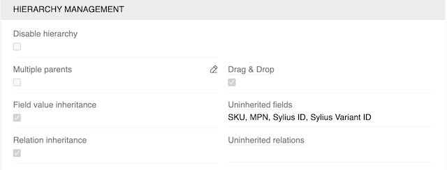

---
title: Entity Types
--- 

AtroCore provides several entity types, each offering distinct capabilities for data management: Base, Hierarchy, Subtype, Reference, Relation and Archive. Base, Hierarchy and Subtype entities can be created in the [Entity Manager](../index.md#required-fields), the other types are provided by AtroCore and its modules.

## Base

The standard entity type that provides basic data management capabilities. This is the most commonly used entity type for most business data.

## Hierarchy

The entity of the Hierarchy type differs from the Basic one in that it allows you to create child records that will inherit the values of fields and attributes from the parent. An additional Hierarchy Management panel with following fields is available for it:  

- **Multiple Parents** - allows to link multiple parents to one child record
- **Drag & Drop** - this option activates hierarchy sort order, so no other sorting is possible in hierarchial navigation
- **Field Value Inheritance** - if this checkbox is selected, child records inherit field values from parent records
- **Uninherited Fields** - values for these fields will not be inherited from the parent item.
- **Relation Inheritance** - if this checkbox is selected, child records inherit relations from parent records
- **Uninherited relations** - relations with these entities will not be inherited from parent item.

For information about inheritance and hierarchies in records, see the [Hierarchies and inheritance](../04.hierarchies-and-inheritance/) documentation.

> An entity of type [Relation](#relation) is also created for each entity of type Hierarchy (for example, there is relation entity ProductHierarchy for hierarchical entity Product) to manage the parent-child connections between records.

## Subtype

A subtype extends an entity of type [Base](#base) - its **supertype** - with the fields and relations of one type of its records. For example, the entity `Product` gets the subtypes `ProductTypeSimple` and `ProductTypeBundle`: every product has the common product fields, a bundle also has the fields that only bundles need.

- **Every record belongs to one subtype.** The supertype gets the `Type` field with an option for each subtype, e.g. `simple` and `bundle`. Creating a record of the supertype starts with choosing its type, and the record is shown with the fields and layouts of its subtype.
- **The common data stays in the supertype.** A subtype stores only its own fields. The list view of the supertype shows the records of all subtypes with the common fields.
- **A subtype has only its own fields and relations.** Name, icon and description of a subtype can be changed, all other settings - access control, activities, attributes and so on - belong to the supertype.
- **Records are managed via the supertype.** A record of a subtype is opened, edited and deleted as a record of the supertype; the subtype has no own navigation item.

Creating a subtype:

- The supertype is an entity of type Base that is not a derived entity.
- The code of the subtype starts with the code of the supertype followed by `Type` and a name starting with a capital letter, e.g. `ProductTypeBundle`.
- The supertype has no records yet when its first subtype is created, and it has no own field `Type`. Once the supertype has subtypes, a new subtype can be added while the supertype contains records - its existing records stay in their subtypes.

Deleting a subtype is possible only when it has no records. An entity that has subtypes is deleted after all its subtypes.

## Reference

Reference is an entity type that can be used to store some guide data that has no relationships to other entities and contains a small number of records. All data of this entity is stored in the configuration file.

Reference is a system entity type: Reference entities are provided by AtroCore and its modules and cannot be created by users.

You cannot configure access rights, use filters, or create fields of the Link or Multiple Link [type](../02.data-types/) for this entity type. The Code field is always created as a system field and cannot be modified.

> **Reference Entity Limitations**
Cannot be referenced by [Multiple-link](../02.data-types/index.md#multiple-link) fields. Other entities cannot create Multiple-link fields that point to Reference entities.

## Relation

 When you create [Many-to-Many relationships](../07.fields-and-relations/index.md#many-to-many-relationships), AtroCore automatically generates a Relation entity to manage the connections between records. You can set the entity name when creating the relationship field (by default, it combines both entity names) and it contains:

- Two Link fields that reference the connected entities
- Standard tracking fields (id, created/modified dates and users).

> Relation entities are also automatically created for [hierarchical](#hierarchy) entities to manage parent-child relationships (e.g., ProductHierarchy for Product entity).

With the [Advanced Data Management](https://store.atrocore.com/en/advanced-data-management/20113) module, you can customize these Relation entities and make them accessible through the main menu.

An entity of type relation inherits the permissions from the two entities it consists of. That is, if the user has permission to create, read and edit the ProductChannel entity, but editing is prohibited for one or both entities (Channel and Product), then the user will not be able to edit the ProductChannel entity either. Thus, in order to have permission to perform some action with an entity of the Relation type, the user must be allowed this action for both the entities that form it, as well as for the Relation entity itself.

 When one of the records in the related entities is deleted, the relationship record remains. Relationship record is deleted when one of the related records is permanently deleted.

Read [Roles](../../14.access-management/03.roles/) for details.

## Archive

The Archive entity type is a system-only entity type used by AtroCore to store historical and system-generated data. Designed for logging and auditing purposes, it cannot be created or customised by end users beyond retention settings.
Examples include:

- Import Log
- Action Excution Log
- Action History Record

Users cannot create or modify Archive-type entities, they can configure the Auto-delete period. This specifies how long archive records should be retained before they are removed automatically by the system. This setting helps to manage database size and ensure compliance with data retention policies. If the auto-delete period is not set, archive data will be retained indefinitely.

Users can choose to avoid losing data in archive-type entities and keep server storage low. This can be achieved via the [ClickHouse](https://store.atrocore.com/en/clickhouse-integration/20246) module.
