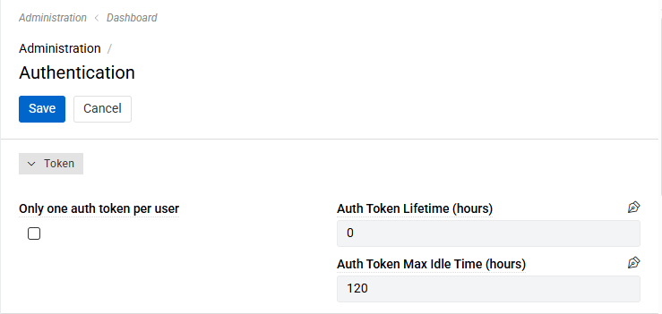
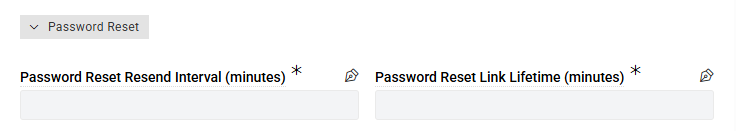
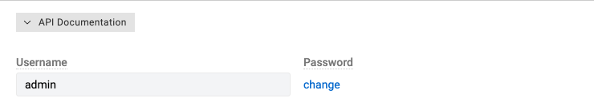

---
title: Authentication
--- 

The Authentication page allows you to configure the sessions of the user interface, the password reset, the rate limiting and the access to the REST API documentation.
To set them go to `Administration / Authentication / Settings`. The applications that call the REST API are registered in `Administration / Authentication / OAuth Clients`, see [OAuth Clients](../06.oauth-clients/index.md).

{.medium}

## Sessions

A user who logs in to the user interface gets a session. The server keeps its OAuth tokens and renews them, the browser has only a session cookie (see [Session Cookie](../../../../09.installation-and-maintenance/02.security-guidance/index.md#session-cookie)).

- **Only one session per user**: logging in ends the other sessions of the user, so a user cannot be logged in on several devices at the same time.
- **Session Lifetime (hours)**: how long a session lasts since the login. Set to 0 (no limit) by default.
- **Session Max Idle Time (hours)**: how long a session lasts since its last use. Set to 120 hours (5 days) by default.

The settings apply to the user interface only. The access tokens of the OAuth clients have their own lifetimes, see [REST API Authentication](../../../../10.developer-guide/10.rest-api/index.md#authentication).

Deactivating a user ends all sessions of the user and revokes the OAuth tokens issued for the user.

For LDAP authentication, see [LDAP authentication](https://store.atrocore.com/en/ldap/20164). For single sign-on, see [Single Sign-On](https://store.atrocore.com/en/microsoft-entra-id-sso/20107).

## Password Reset

The *Password Reset* panel controls the password reset links that users request with **Forgot Password?** on the login page and that administrators send with the [Reset Password](../01.users/index.md#password-operations) action.

<!-- To Do: add screenshot of the Password Reset panel -->
{.medium}

- **Password Reset Resend Interval (minutes)**: defines how long a user has to wait before requesting another password reset link. Set to 1 minute by default.
- **Password Reset Link Lifetime (minutes)**: defines how long the password reset link sent by email stays valid. Set to 15 minutes by default.

The minimum value for both settings is 1 minute.

If a user requests a new link before the resend interval has passed, the request is rejected with a message telling the user how many minutes to wait. The resend interval does not apply to the **Reset Password** action of administrators.

Only the most recent password reset link of a user is valid – each new link replaces the previous one. A link also stops working once the password has been changed with it. A change of the link lifetime applies to links that have already been sent.

! Password reset works only if the **Connection for E-Mail Notifications** is set in the [system settings](../../01.system-settings/index.md#notifications). Otherwise, the **Forgot Password?** link is not shown on the login page.

## Rate Limit

The *Rate Limit* panel protects the login and the password reset request from automated abuse. Clients that send too many requests receive the status `429 Too Many Requests` and have to wait before trying again.

- **Rate Limit: Requests**: how many requests one IP address may send to a limited endpoint within the period. Set to 3 by default.
- **Rate Limit: Period (seconds)**: the length of that period. Fractions are allowed, for example `0.5`. Set to 1 second by default.
- **Max Source IPs Per User**: how many different IP addresses may be used for the same user name within 60 seconds when logging in. Set to 5 by default.

The login is limited per IP address and per user name; the password reset request per IP address. All other API requests are not limited. Users behind one shared address (for example an office network) share the limit of that address, so raise **Rate Limit: Requests** if many of them open the application at the same moment.

For details, including how to limit requests in the web server in addition, see [Rate Limiting](../../../../08.security/02.rate-limiting/index.md).

## API Documentation

The *API Documentation* panel protects the REST API documentation at `/apidocs/` and its OpenAPI schema with HTTP Basic authentication.

{.medium}

- **Username**: the user name for the API documentation.
- **Password**: the password for the API documentation. It is stored only as a hash and is never shown – leave the field empty to keep the current password.

These credentials are independent of AtroCore users – any person who knows them can open the API documentation, without an AtroCore account.

Both fields are empty by default, and the API documentation is not accessible (`401 Unauthorized`) until both a username and a password are set. To disable access again, clear the **Username** and save – the stored password is removed as well, so a new password has to be set to enable the API documentation again.
