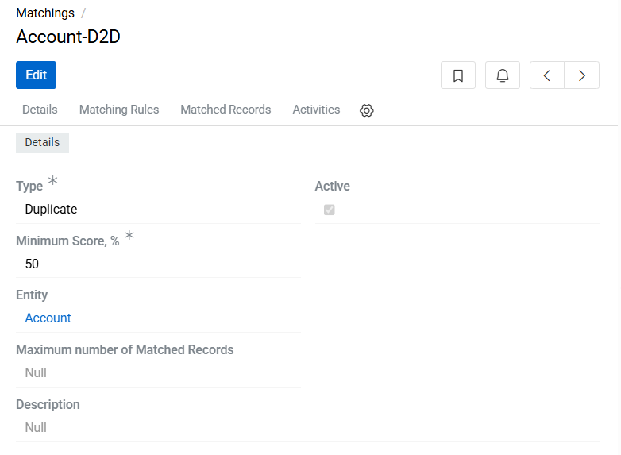
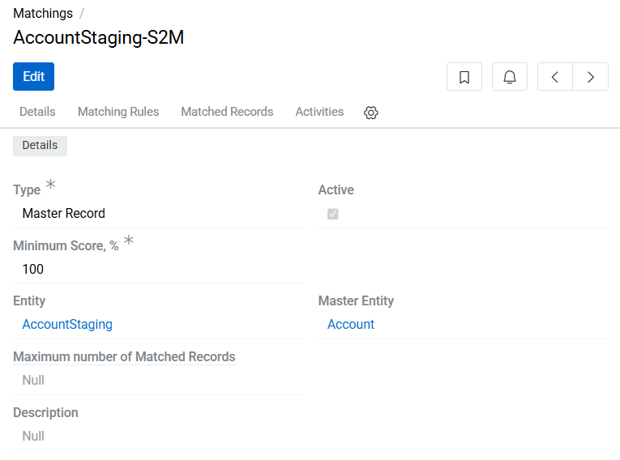
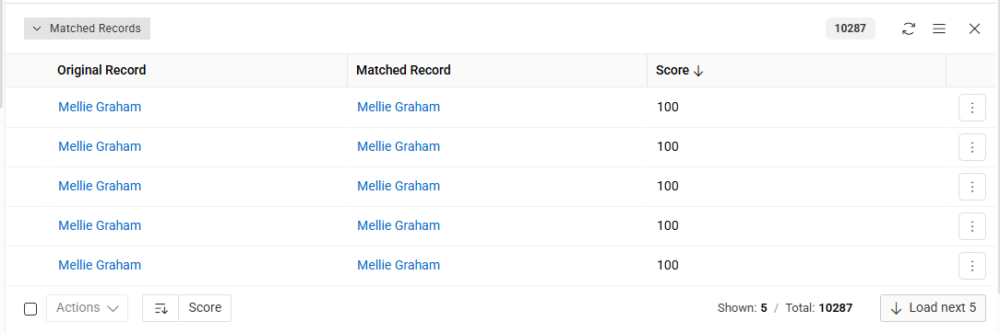

AtroCore provides an automated mechanism for identifying similar or duplicate entity records. This functionality is configured through the Matchings feature.

To define similarity criteria, navigate to `Administration / Matchings` and create a Matching configuration record. The matching operations run in the background through a dedicated [scheduled job](../../../01.atrocore/03.administration/05.system-jobs/01.scheduled-jobs/index.md#find-matches), which evaluates new and updated records against the rules of every active Matching.

## How Matching Works

Each record is processed in two steps:

1. **Candidate selection** – the [Blocking Rules](#blocking-rules) of the Matching select the records that are worth comparing with the current record. The selection is done by the database, so only a small part of the records is loaded.
2. **Scoring** – every candidate is compared with the current record by the [Matching Rules](#matching-rules). The weights of the rules that evaluate as true are summed and converted into a percentage of the maximum possible score. If the percentage meets or exceeds the Minimum Score, a [Matched Record](#viewing-matched-records) is created.

A pair of records that is not selected by the Blocking Rules is never scored, even if the Matching Rules would evaluate as true for it.

Example: a Matching of persons has the following rules:

| Blocking Rules (operator OR) | Matching Rules | Weight |
|---|---|---|
| Phone – Field is Equal | Phone – Field is Equal | 40 |
| Name – Field is Similar | Name – Field is Similar | 30 |
| Email – Field is Equal | Email – Field is Equal | 40 |

The Minimum Score is 50%. For a record with name "Anna Smith", the candidates are all records with the same phone, the same normalized name or the same email. A candidate with the same name and email gets 70 of 110, i.e. 63%, and is a match. A candidate with the same name only gets 30 of 110, i.e. 27%, and is not.

## Matching Configuration

A Matching record defines how the system evaluates entities for potential duplicates.
The following parameters are available when configuring a Matching:

- Number – an auto-generated sequential identifier assigned to the record on save. It also serves as the record's label. This field is immutable after creation.
- Active – when enabled, the system evaluates matching conditions automatically:
  - On creation of new records in the selected entity.
  - Whenever a field used by the Blocking Rules or Matching Rules is modified.

  A Matching can be activated only if it has at least one Blocking Rule and one Matching Rule. The rules can be added, changed or removed only while the Matching is inactive.
- Type – determines how the system compares entities. This field is immutable after creation and accepts the following values:
  - Duplicate - Duplicate – compares records within the same entity to detect duplicates.

  <!-- To Do 11.11.26
  Replace both Matching Configuration screenshots: show the Blocking Rules and Matching Rules panels with the fields of the rule subtypes (Field, Operator) once the list layout of a supertype supports adding the fields of its subtypes.
  -->

  {.medium}

  - Contributor - Master – compares records of a contributor entity with the records of its master entity.

  {.medium}

- Description – optional text describing the matching logic or purpose.
- Minimum Score, % – the minimum score required for a match, as a percentage of the sum of the weights of all top-level Matching Rules.
  - Example: if two Matching Rules have weights of 20 and 30 and the Minimum Score is 50%, a candidate must reach at least 25 of 50. This is possible only if the rule with the weight of 30 or both rules evaluate as true.
- Entity – the entity whose records are checked (e.g., Product, Account).
- Master Entity – the entity whose records are searched for matches. For Duplicate - Duplicate matchings, it is the same as Entity.
- Blocking Operator – defines how the top-level Blocking Rules are combined:
  - OR (default) – a record is a candidate if at least one Blocking Rule selects it.
  - AND – a record is a candidate only if all Blocking Rules select it. A rule whose field is empty in the current record selects nothing, so such a record gets no candidates.
- Maximum number of Matched Records – the maximum number of matched records allowed for a single record. If a record has more matches than this value, the Matching is deactivated. Leave this field empty to allow an unlimited number of matched records.

## Blocking Rules

Blocking Rules select the candidates for comparison. They have no weight and do not affect the score. Multiple Blocking Rules can be associated with a single Matching record; the top-level rules are combined by the Blocking Operator of the Matching.

Blocking Rules should select as few candidates as possible while not missing any real match. A rule on a field with many identical values, e.g. a birth date, selects many candidates and slows down the matching.

The following parameters are available when defining a Blocking Rule:

- Number – an auto-generated sequential identifier assigned to the rule on save. This field is immutable after creation.
- Type – determines how candidates are selected. Immutable after creation. Available types:
  - Field is Equal – selects the records with exactly the same value.
  - Field is Similar – selects the records with the same value after normalization (lowercased, trimmed, spaces removed). For array-based fields ([array](../../03.administration/11.entity-management/02.data-types/index.md#array), [multi-value list](../../03.administration/11.entity-management/02.data-types/index.md#multi-value-list)), selects the records that share at least one value with the current record.
  - Field Contains – selects the records whose value contains the value of the current record. For Duplicate - Duplicate matchings, the records whose value is contained in the value of the current record are selected as well. For array-based fields, selects the records that share at least one value with the current record.
  - Set – a group of subordinate Blocking Rules combined by its own Operator (AND or OR). A Set allows combining conditions with a different operator than the Blocking Operator of the Matching, e.g. "same phone OR (same last name AND same birth date)".
  - Expression – selects the candidates by a custom condition written in [Expression Language](../../../10.developer-guide/85.expression-language/index.md#matching-rule-expressions) in the Matched Where Expression field. Use it when the built-in types can't express the condition you need, e.g. comparing the record's name with a candidate's translated name.

  The [Advanced Data Management](https://store.atrocore.com/en/advanced-data-management/20113) module provides additional rule types for approximate matching: Field is Similar (Fuzzy) and Field is Similar (Levenshtein).
- Matching – references the parent Matching configuration. Immutable after creation.
- Field – the field (or attribute) whose value is compared, chosen from the Master Entity of the Matching. Only fields whose type is supported by the selected rule Type are offered. The value of the current record is read from the identically named field. For entities that support [attributes](../../03.administration/12.attribute-management/index.md), an attribute can be selected instead by choosing **[Add Attribute]** from the field dropdown.

> An empty value of the current record selects no candidates.

## Matching Rules

Matching Rules score the candidates selected by the Blocking Rules. Multiple Matching Rules can be associated with a single Matching record.

The following parameters are available when defining a Matching Rule:

- Number – an auto-generated sequential identifier assigned to the rule on save. This field is immutable after creation.
- Type – determines how field values are compared. Immutable after creation. Available types:
  - Field is Equal – strict equality between values.
  - Field is Similar – normalized string comparison (lowercased, trimmed, spaces removed). For array-based fields ([array](../../03.administration/11.entity-management/02.data-types/index.md#array), [multi-value list](../../03.administration/11.entity-management/02.data-types/index.md#multi-value-list)), values are considered similar if they contain the same elements regardless of order. Example: [1,2,3] and [1,3,2] are considered similar.
  - Field Contains – checks if the candidate value contains the value of the current record. For array-based fields, all elements of the current record's value must be present in the candidate value. Example: [1,2] and [3,1,2] – the second value contains the first.
  - Set – a group of subordinate Matching Rules evaluated together as a single weighted rule. A Set has an Operator parameter that defines how its sub-rules are evaluated:
    - Operator: AND – the Set scores the sum of the scores of its sub-rules.
    - Operator: OR – the Set scores the score of the sub-rule with the highest weight that evaluates as true.
  - Expression – scores a candidate by a custom [Expression Language](../../../10.developer-guide/85.expression-language/index.md#matching-rule-expressions) expression in the Score Expression field. The expression returns a number from 0 to 1, which is multiplied by the rule's Weight.

  The [Advanced Data Management](https://store.atrocore.com/en/advanced-data-management/20113) module provides additional rule types for approximate matching: Field is Similar (Fuzzy) and Field is Similar (Levenshtein).
- Matching – references the parent Matching configuration. Immutable after creation.
- Weight – numerical value defining the rule's importance in the overall score. For the Set type, the weight is calculated from its sub-rules: the sum of their weights for the AND operator, or the highest of them for OR.
- Field – the field (or attribute) being compared, chosen from the Master Entity of the Matching. Only fields whose type is supported by the selected rule Type are offered.
  - For Duplicate - Duplicate matchings, this is the field compared between the two records within the same entity.
  - For Contributor - Master matchings, the value is read from the Contributor Entity record and compared with the value of the identically named field of the Master Entity candidate.
  - For entities that support [attributes](../../03.administration/12.attribute-management/index.md) (e.g., Product, Listing), an attribute can be selected instead of a regular field by choosing **[Add Attribute]** from the field dropdown. Only attribute types compatible with the selected rule type are shown. If the attribute value is absent in either compared record, the rule contributes a score of `0` for that pair.

> If the value is empty in either compared record, the rule scores `0`.

For Duplicate - Duplicate matchings, the score of a pair does not depend on which of the two records is checked. If the Matching has a rule whose result depends on the direction of the comparison, i.e. Field Contains or Expression, the pair is scored in both directions and gets the higher score.

> Each Blocking Rule and Matching Rule belongs to one Matching only.

## Viewing Matched Records

Each Matched Record contains the Match Subject, the Match Candidate and the Score of the match in percent. For Contributor - Master matchings, the Match Subject is the contributor record and the Match Candidate is the master record. For Duplicate - Duplicate matchings, one Matched Record is stored per pair of records, regardless of which of the two records was checked, so the Match Subject is not necessarily the record for which the matches were searched.

All matched records can be reviewed in the following ways:

- Matched Records entity – displays a list of all detected matches across the system, regardless of the Matching configuration or entity involved.
- Matched Records panel in a Matching record – shows only the records that matched according to that specific Matching configuration.
- Right sidebar in the matched entity record – when opening a record, the `Matched records` panel in the [Insights tab](../../../01.atrocore/04.understanding-ui/index.md#insights-tab) displays all records detected as matches for that record.

{.medium}

Matched Records are the basis for [Clusters](../19.clusters/index.md), which group all records that are connected by matches.
