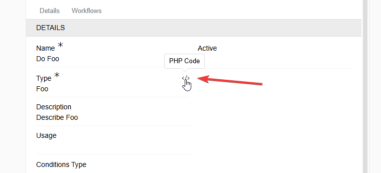
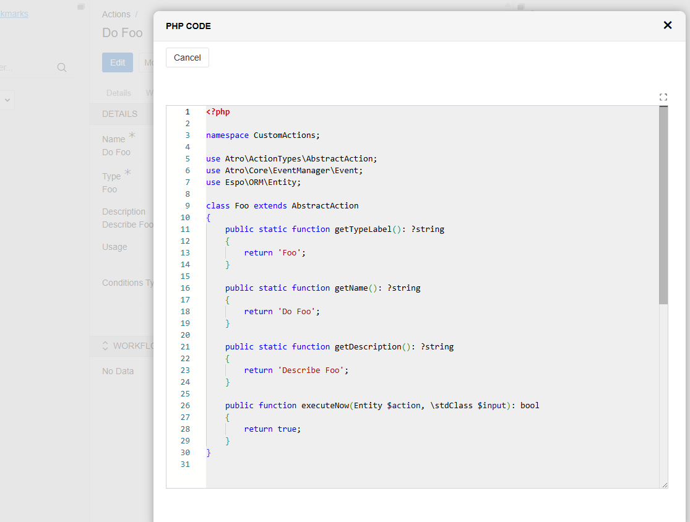

## Overview

The system features a flexible and extensible framework for configuring **Actions**, allowing users to define and customize various automated tasks. While a wide range of standard action types with configurable options is already available, the system also supports the development of **custom action types** to address specific or complex use cases that require bespoke logic beyond standard configurations.

## Purpose

The purpose of custom action types is to provide a flexible mechanism for implementing complex or unique business logic that cannot be efficiently handled by the standard predefined action types. This enables the system to be extended easily to meet specific requirements without compromising performance or maintainability.

## Use Cases

- Implementing specialized workflows unique to certain business processes.
- Performing optimized operations that standard action types cannot efficiently execute.
- Integrating with external systems or APIs with custom logic.
- Automating tasks that require complex conditions or calculations.
- Adding new types of automated actions without modifying the core system.

## Benefits

- **Flexibility:** Allows developers to implement any required logic tailored to specific needs.
- **Performance:** Enables optimized execution for complex or resource-heavy tasks.
- **Extensibility:** Supports seamless system extension without core modifications.
- **Maintainability:** Centralizes action logic, simplifying updates and debugging.
- **Consistency:** Custom actions integrate fully with existing UI and trigger mechanisms.


## Creating a Custom Action Type

Developers can create a new custom action type by running the following command on the server:

```bash
php console.php create action Foo
```
Here, `Foo` is the name of the new action type.

This command generates a PHP file on the server with a skeleton class, for example:

```php
<?php

namespace CustomActions;

use Atro\ActionTypes\AbstractAction;
use Atro\Core\EventManager\Event;
use Espo\ORM\Entity;

class Foo extends AbstractAction
{
    public static function getTypeLabel(): ?string
    {
        return 'Foo';
    }

    public static function getName(): ?string
    {
        return 'Do Foo';
    }

    public static function getDescription(): ?string
    {
        return 'Describe Foo';
    }

    public function executeNow(Entity $action, \stdClass $input): bool
    {
        return true;
    }
}
```

## Key Methods

| Method Signature                                    | Description                                                                                     |
|---------------------------------------------------|-------------------------------------------------------------------------------------------------|
| `getTypeLabel()`  | Returns a short label identifying the action type. Example: `'Foo'`.                           |
| `getName()`       | Returns the default name of the Action type. If the user selects this action type but does not provide a custom name, the system uses this value automatically. Example: `'Do Foo'`.              |
| `getDescription()`| Returns the default description of the Action type. If the user does not provide a description during creation, the system uses this value. Example: `'Describe Foo'`.                |
| `executeNow(Entity $action, \stdClass $input)` | Contains the main execution logic of the action. Returns `true` or `false`. |
| `executeWithResult(ActionExecution $execution, \stdClass $input)` | Optional. Contains the main execution logic of the action and returns an `ActionResultDTO` (see below). The action record is available as `$execution->get('action')`. |

### Action Result

An action can tell the system what happened by implementing `executeWithResult()` and `execute()`:

```php
use Atro\DTOs\ActionResultDTO;
use Atro\Entities\ActionExecution;

public function execute(ActionExecution $execution, \stdClass $input): bool
{
    return $this->executeWithResult($execution, $input)->toBool();
}
```

`executeWithResult()` returns an `Atro\DTOs\ActionResultDTO`:

| Property | Meaning |
|----------|---------|
| `executed` | `false` when the action did not run (conditions not met, nothing to do), `true` otherwise. |
| `inBackground` | `true` when the work was handed over to background jobs, `false` when it was finished right away. |
| `success` | Whether the action succeeded. |
| `message` | Optional text. |

| Factory | Use it when |
|---------|-------------|
| `ActionResultDTO::done()` | The action finished right away. |
| `ActionResultDTO::queued()` | The action created background jobs. |
| `ActionResultDTO::skipped('reason')` | There was nothing to do. |
| `ActionResultDTO::failed('reason')` | The action ran and failed. |

```php
public function executeWithResult(ActionExecution $execution, \stdClass $input): ActionResultDTO
{
    $action = $execution->get('action');

    if ($nothingToDo) {
        return ActionResultDTO::skipped('There are no records to process.');
    }

    if ($jobsWereCreated) {
        return ActionResultDTO::queued();
    }

    return ActionResultDTO::done();
}
```

An Action Set uses the result to decide when to run its next action: right after an action that finished or was skipped, and once all background jobs are finished after an action that returned `queued()`. An action that creates background jobs has to return `queued()`.

The status of the action execution is set to `done` when the action returns a result that is not in the background. An action that returns `queued()` sets the status itself: call `$this->markExecutionDone($execution)`, or leave the execution `running` until its jobs are finished.

The REST response of an action contains `success`, `message`, `executed` and, when the work was queued, `inBackground`.

---

## Bulk Action Type (`AbstractBulkAction`)

A custom action that needs to run the same logic over **many records at once** — instead of a single triggering record — should extend `Atro\ActionTypes\AbstractBulkAction` rather than `AbstractAction`. It already implements the mass-processing mechanics (record fan-out, chunking into background jobs for large sets, per-record logging) so the developer only has to implement what happens for one record.

```php
<?php

namespace CustomActions;

use Atro\ActionTypes\AbstractBulkAction;
use Espo\ORM\Entity;

class Foo extends AbstractBulkAction
{
    public static function getTypeLabel(): ?string
    {
        return 'Foo';
    }

    public static function getName(): ?string
    {
        return 'Do Foo';
    }

    public static function getDescription(): ?string
    {
        return 'Describe Foo';
    }

    protected function processEntity(Entity $entity, Entity $log): bool
    {
        // Custom logic for one record. Return true on success, false if the
        // action was not applicable / failed for $entity.
        // Optionally override the default outcome by setting $log->set('type', ...)
        // and $log->set('message', ...) before returning.

        return true;
    }
}
```

Only `processEntity(Entity $entity, Entity $log): bool` needs to be implemented — it is called once per processed record, and `$log` is the `ActionExecutionLog` entity being built for that record.

### Two Run Modes

An Action based on `AbstractBulkAction` supports two mutually exclusive modes, toggled by the **Apply to preselected records** field:

| Mode | Apply to preselected records | Behavior |
|---|---|---|
| Search Entity | Off | The action defines its own static filter (**Search Entity** + condition/`where`). Every run processes all records currently matching that filter. |
| Preselected Records | On | The action is meant to be run from the mass-actions dropdown of a list view. It processes only the records the user has checked, or every record matching the list's current search when **select all matching** is used. |

Both the **Search Entity** and **Apply to preselected records** fields on the Action form become available automatically for any action type that extends `AbstractBulkAction` — a custom action registered under `data/custom-code/CustomActions/` does not need any extra metadata to expose them.

---

## UI Preview of Custom Code

To improve developer experience, the system provides a convenient way to preview the implementation of a custom Action directly from the UI.

- Clicking this icon opens a preview of the code behind the selected type.
  
- The modal window that appears after clicking the icon. It contains a read-only view of the corresponding PHP class, making it easy to inspect the logic without leaving the UI.
  

This feature is intended to make debugging and reviewing logic easier for developers and administrators.